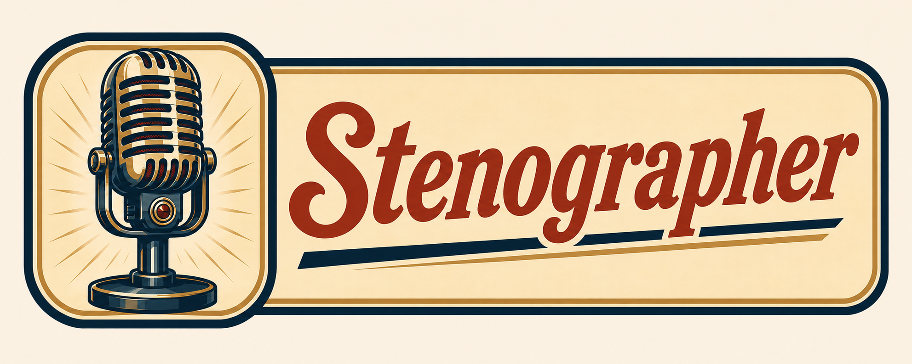
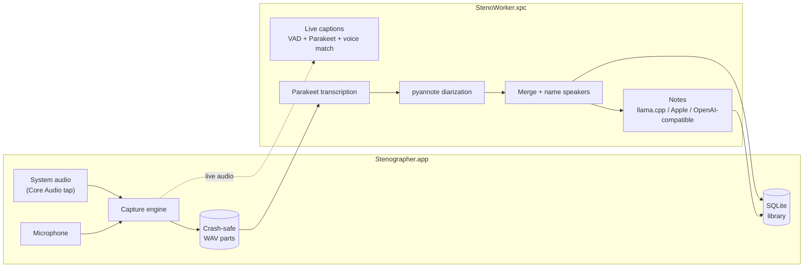

<p align="center">
  
</p>

<p align="center">
  <b>Record meetings. Transcribe them on your Mac. Know who said what. Turn it into notes.</b>
</p>

<p align="center">
  <a href="https://github.com/ChrisZiraldo/Stenographer/releases/latest"></a>
  <a href="LICENSE"></a>
  
  
</p>

<p align="center">
  <a href="#download">Download</a> ·
  <a href="#features">Features</a> ·
  <a href="#how-it-works">How it works</a> ·
  <a href="#build-from-source">Build</a> ·
  <a href="#the-steno-cli">CLI</a> ·
  <a href="#contributing">Contributing</a>
</p>

---

Stenographer is a native macOS app for meeting notes. It captures your microphone and the other side of the call, transcribes with on-device models, labels each speaker, and writes notes with a local or remote LLM. Audio and transcripts stay on your Mac unless you point note generation at a remote endpoint.

## Download

Get the latest build from the [Releases page](https://github.com/ChrisZiraldo/Stenographer/releases/latest) (`Stenographer-<version>.zip`, Apple Silicon, macOS 26 or later).

1. Unzip and drag `Stenographer.app` into `/Applications`.
2. The app is not notarized, so clear the quarantine flag once, then open it:
   ```sh
   xattr -dr com.apple.quarantine /Applications/Stenographer.app
   ```
   (Or open it, let macOS block it, then System Settings → Privacy & Security → Open Anyway.)
3. Allow Microphone and System Audio Recording when asked. Each release is signed differently, so macOS asks again after you update.
4. The first launch downloads about 1 GB of speech models.

## Features

| | |
|---|---|
| 🎙️ **Reliable capture** | System audio through Core Audio process taps plus your microphone, written continuously to crash-safe 16 kHz WAV parts with sample-aligned timing. Device changes and sleep start a new part; a crash is repaired on next launch. |
| ⚡ **Live captions** | Parakeet TDT 0.6B v3 on the Neural Engine. Speakers are named from your saved voices, and unknown people show as "Speaker N". |
| 🗣️ **Who said what** | pyannote community-1 diarization. Name a speaker once and choose "Remember this voice"; later meetings are labelled automatically. A People panel lists everyone with their meeting history. |
| 📝 **Formatted notes** | Write your own notes with bold, italic, underline, font, size, color and alignment, saved with each meeting. |
| 🤖 **AI notes** | Generate notes from templates with a built-in llama.cpp model (downloaded once, then fully offline), Apple's on-device model, or any OpenAI-compatible endpoint (Ollama, LM Studio, cloud). Markdown export. |
| 💬 **Right now** | While recording, a "Right now" tab keeps a running catch-up summary of the last few minutes (the current topic, what was just said, and any open question), refreshed every 30 seconds by default (configurable in Settings → AI). Uses your configured AI provider; a remote endpoint receives the live transcript text. |
| 🔎 **Search** | Full-text search over titles, notes and transcripts. |
| 🛡️ **Crash isolation** | Speech and language models run in an XPC worker, so a model crash never takes down a recording. |
| 🎛️ **Quick controls** | Recording mode (call, in person, system audio only), microphone and live captions are one click away in the toolbar. |

## How it works



Capture never depends on the models: audio goes to disk first, and processing is a resumable job queue. The manifest in each session folder is the source of truth for capture; the database is an index that startup recovery rebuilds.

## Permissions

Microphone, and System Audio Recording under System Settings → Privacy & Security → Screen & System Audio Recording. The onboarding sheet walks through both.

## Your data

Everything lives in `~/Library/Application Support/Stenographer/`: a SQLite index plus one folder per session (manifest, audio, transcripts) and downloaded language models. Nothing is sent anywhere except note generation, and only if you choose a remote endpoint.

## Build from source

Requires macOS 26, Apple Silicon, Xcode 27 / Swift 6.4 and [xcodegen](https://github.com/yonaskolb/XcodeGen).

```sh
swift build && swift test            # core libraries and the `steno` CLI

cd App && xcodegen generate && cd ..
xcodebuild -project App/Stenographer.xcodeproj -scheme Stenographer \
  -configuration Release -derivedDataPath .build/xcode build
open .build/xcode/Build/Products/Release/Stenographer.app
```

`App/project.yml` sets the signing team and identity; change them to yours. A stable signature is needed for the system-audio permission to persist.

Tests that need downloaded models run with `STENO_MODEL_TESTS=1 swift test` after `Scripts/make-fixtures.sh`.

## The `steno` CLI

Every pipeline stage is also a command: `devices`, `record`, `recover`, `finalize`, `import`, `transcribe`, `diarize`, `process`, `notes` and `live-replay`. Run `steno --help`. Build it signed with `Scripts/sign-cli.sh`, and use `Scripts/capture-check.sh` for a timed system-audio capture check.

## Project layout

| Path | Contents |
|---|---|
| `Sources/StenoModel` | Shared types, manifest IO, voice-vector math |
| `Sources/StenoAudio` | Capture engine, WAV storage, finalize, import |
| `Sources/StenoPipeline` | ASR, diarization, transcript merge, live captions |
| `Sources/StenoStore` | SQLite store, job queue, recovery, speaker library |
| `Sources/StenoLlama` | Built-in llama.cpp engine (runs in the XPC worker) |
| `Sources/StenoNotes` | LLM providers, templates, note generation |
| `Sources/StenoXPC` | App/worker XPC protocols |
| `Sources/steno` | CLI |
| `App/` | SwiftUI app and XPC worker (xcodegen project) |
| `Scripts/` | Release build (`dist.sh`), CLI signing, fixtures, capture check |
| `.github/workflows/` | Release workflow |
| `VERSION` | Version number; changing it on `main` cuts a release |
| `assets/` | Icon and logo source art |

## Releases

Bump the number in `VERSION` and push to `main`. `.github/workflows/release.yml` builds `Scripts/dist.sh` on a macOS 26 runner and publishes a GitHub Release `v<VERSION>` with `Stenographer-<VERSION>.zip`. If that tag already exists, nothing happens. The build is ad-hoc signed and not notarized; the zip includes an `OPEN-ME.txt` with the steps under [Download](#download). Run `bash Scripts/dist.sh` to build the same zip locally into `dist/`.

## Known limitations

- Builds are not notarized, so the first launch needs the quarantine step above.
- Apple Silicon and macOS 26 or later only.
- Live speaker labels are provisional; the final transcript is relabelled by the offline pass when you stop recording.
- Formatting in your notes is not carried into the Markdown export or the AI prompt, which use the plain text.

## Contributing

Issues and pull requests are welcome. Before opening a PR, run `swift build && swift test` and, for app changes, build the Release app as above. Keep changes focused, and add a test when you fix a bug or change behavior that other code relies on.

## Acknowledgements

Built on [FluidAudio](https://github.com/FluidInference/FluidAudio) (Parakeet and pyannote on Core ML), [llama.cpp](https://github.com/ggml-org/llama.cpp) via [llama.swift](https://github.com/mattt/llama.swift), [GRDB](https://github.com/groue/GRDB.swift), [swift-markdown-ui](https://github.com/gonzalezreal/swift-markdown-ui) and [swift-argument-parser](https://github.com/apple/swift-argument-parser).

## License

[MIT](LICENSE)
